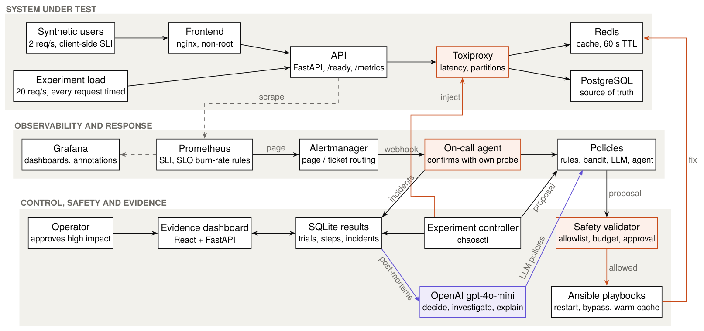
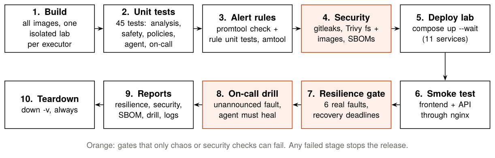

# CHAOS OS

*Break it. Learn from it. Build infrastructure that survives it.*

CHAOS OS is a local resilience lab. It injects real failures into a small web
shop running under steady load, lets competing **recovery policies** choose
what to do, checks every proposed action against a **safety validator**,
measures recovery **request by request**, and gates releases in **Jenkins** on
the results. A contextual bandit learns which fix works for which symptoms, an
**LLM agent** investigates with real tools before acting, and an always-on
**on-call agent**, paged by SLO burn-rate alerts, heals failures nobody
announced, asking a human before anything high impact. gpt-4o-mini explains
the evidence in plain English.

📄 **Read more:** the [IEEE-format paper](docs/paper/CHAOS-OS-IEEE-paper.pdf) ·
the [team study guide](docs/study-guide/CHAOS-OS-Study-Guide.pdf)
([Word](docs/study-guide/CHAOS-OS-Study-Guide.docx)) · the [demo runbook](docs/DEMO.md)

**Headline results (all measured, see [Results](#results)):**

- **No single fix works everywhere.** Each of the 5 training failures has a
  different best action; picking the wrong one costs 450–1,100 failed requests
  instead of 30–250.
- **The learned policy (LinUCB bandit) reaches 98 % best-action accuracy** from
  52 logged experiments, against 40 % for a conventional "restart what looks
  broken" runbook. It equals the hand-written expert rules, without anyone
  writing its rules.
- **It generalizes to an unseen failure.** On a held-out Redis network cut the
  bandit recovered 3/3 in 0.8 s, while the runbook failed 3/3 and the LLM took 43 s.
- **It does not solve compound failures.** No policy recovered from "Redis
  killed + slow database" (0/12). That is the clearest limitation.
- **For the LLM, advice and evidence interact.** In a 2 x 2 ablation, one
  paragraph of generic SRE guidance replaced gpt-4o-mini's restart-first habit
  with a bypass-first habit (Redis latency 50.1 s → 3.3 s), but alone it never
  restarted a crashed database; tools alone only added 8-12 s; tools plus
  guidance handled both kinds of fault (see [LLM ablation](#5-llm-ablation-tools-x-advice)).
- **The on-call agent heals failures nobody announced:** 18 of 21 unannounced
  faults healed (the 3 others, the unsolvable compound fault, were escalated),
  median 11.8 s from fault to page and 25.8 s to healthy traffic,
  with human approval for high-impact fixes (see [On-call mode](#on-call-mode)).
- **The safety validator blocked every unsafe proposal**; zero unsafe actions
  ever executed.
- **The CI gate catches a bug that unit and smoke tests miss** (see
  [Resilience gate](#resilience-gate)), and every build also runs secret,
  dependency and image scans and an unannounced on-call drill.

---

## Architecture



The API reaches Redis and Postgres **through Toxiproxy**, so latency and
outages can be injected without touching the services themselves. Synthetic
users measure the SLO from the client side; Prometheus pages the on-call agent
through Alertmanager. Jenkins runs separately and gives every build its own
isolated copy of the lab.

## How an experiment works

Every trial is a small incident, handled the way an on-call engineer would:

1. **Reset** the lab to a known-good state (faults cleared, cache flushed).
2. **Warm up** for 15 s at 20 req/s; trials with an unhealthy baseline are discarded.
3. **Inject** the fault and **detect** the outage from live traffic.
4. **Remediation loop** (at most 3 actions):
   observe symptoms → the policy proposes an action → the **safety validator**
   allows or blocks it → the action runs as an **Ansible playbook** → wait up
   to 20 s for the service to heal → repeat if it did not.
5. **Measure** recovery and save the trial and each step to SQLite.

**Recovery definition** ([analysis.py](controller/chaosctl/analysis.py), unit-tested):
time is split into 1 s windows; a window is healthy when ≥ 99 % of requests
succeed and p95 ≤ 300 ms. The service has recovered after 5 consecutive
healthy windows. Recovery time runs from fault injection to the first request
after the last bad one. Prometheus (5 s scrapes) is too coarse for this, so
the load generator measures every request itself.

**Symptoms, not answers.** Policies only see what an operator could observe:
error rate, p95 latency, whether the API answers, and Redis/Postgres
reachability and probe latency. They never see the name of the injected fault.

### Failures

| Failure | Fault | Set |
|---|---|---|
| `redis_down` | Redis container killed | training |
| `redis_latency` | 800 ms latency to Redis | training |
| `postgres_latency` | 400 ms latency to Postgres | training |
| `postgres_down` | Postgres container killed | training |
| `api_crash` | API container killed | training |
| `redis_partition` | network path to Redis cut, container healthy | **held out** |
| `redis_down_slow_db` | Redis killed + 400 ms Postgres latency | **held out** |

Held-out failures were never used to design or train anything, and were run
only once the policies were frozen.

### Recovery actions (Ansible playbooks)

| Action | What it does | Safety impact |
|---|---|---|
| `restart_redis` / `restart_api` | restart the container, wait for `/ready` | medium |
| `restart_postgres` | restart the database | **high** (needs approval) |
| `cache_bypass` | serve reads from Postgres, skipping Redis | low |
| `warm_cache` | preload all items into Redis with one query | low |

### Policies

| Policy | How it decides |
|---|---|
| `rule_based` | Conventional runbook: restart whatever looks broken, then restart the app |
| `heuristic` | Expert rules written from the measured characteristics of each failure |
| `bandit` | LinUCB contextual bandit trained on logged steps; reward = heal speed − safety cost |
| `llm` | gpt-4o-mini reads the symptoms and picks an action (still safety-checked) |
| `llm_agent` | gpt-4o-mini **agent** that must investigate with read-only tools (PromQL, container logs, container states, readiness) before deciding; every tool call is kept as an auditable trail |
| `llm_sre`, `llm_agent_sre` | Ablation variants: the same two, plus one paragraph of generic SRE guidance (no failure names) |
| `adversarial` | Red-team policy that proposes unsafe actions on purpose |

## On-call mode

Experiments know what they broke and when. On-call mode does not: it heals
failures **nobody announced**, the way a human on-call engineer does.

1. **Synthetic users** (2 req/s) measure the SLI: a request is good when it
   returns 200 within 300 ms. The **SLO** is 99 % good.
2. **Prometheus** pages when the error budget burns more than **14.4x** too fast
   over both 1 minute and 20 seconds (the SRE Workbook's multi-window
   burn-rate rule, scaled to lab time; unit-tested with `promtool`).
3. **Alertmanager** delivers the page to the **on-call agent**'s webhook.
4. The agent **confirms** with its own probe traffic (a stale page opens no
   incident), then runs the same remediation loop as experiments, through the
   safety validator.
5. **High-impact actions wait for a human** on the dashboard's On-call page;
   no decision in 60 s means the action is not run (fail safe).
6. It closes the incident on sustained recovery, otherwise **escalates** (no
   retry loops), and gpt-4o-mini writes the **post-mortem**.

The agent runs in its own container and never reads the chaos log. On the chaos
side, the dashboard can **Break it** (a chosen or random fault, unannounced), a
**chaos monkey** can inject random faults on a jittered schedule, and every
fault is rolled back after 5 minutes. A scorecard matches each fault to the
incident the agent opened and measures time to alert, to engage and to recover.

```powershell
docker compose run --rm controller drill --scenario redis_down   # unannounced drill (also a CI stage)
python scripts/oncall_campaign.py --reps 3                      # the measurement campaign
```

---

## Results

All numbers below come from the experiment database. Load is 20 req/s, so a
60 s outage is about 1,200 failed requests.

### 1. Every failure needs a different fix (fixed-action matrix, 2 trials each)

| Failure | Best action | Recovery | Failed req | Other actions |
|---|---|---|---|---|
| `redis_down` | `cache_bypass` | 1.8 s | 34 | `restart_redis` also works (2.0 s); rest never recover |
| `redis_latency` | `cache_bypass` | 1.9 s | 38 | all others fail, **including `restart_redis`** |
| `postgres_latency` | `warm_cache` | 9.0 s | 116 | all others fail; `cache_bypass` makes it worse |
| `postgres_down` | `restart_postgres` | 6.9 s | 76 | all others fail |
| `api_crash` | `restart_api` | 14.6 s | 252 | all others fail |

### 2. Policies on the training failures (2 trials each)

| Failure | Rule-based | Heuristic | Bandit | LLM |
|---|---|---|---|---|
| `redis_down` | ✓ 2.9 s | ✓ 1.6 s | ✓ **1.6 s** | ✓ 4.0 s |
| `redis_latency` | ✕ 0/2 | ✓ 2.8 s | ✓ **2.7 s** | ✓ 28.9 s (5–53 s) |
| `postgres_latency` | ✕ 0/2 | ✓ 9.8 s | ✓ 32.7 s (10–55 s) | ✕ 0/2 |
| `postgres_down` | ✓ 7.4 s | ✓ 8.0 s | ✓ 43.2 s (8–79 s) | ✓ 12.0 s |
| `api_crash` | ✓ 16.1 s | ✓ 16.0 s | ✓ 16.0 s | ✓ 16.1 s |
| **Recovered** | **6/10** | **12/12*** | **10/10** | **8/10** |

\* The heuristic has two extra early runs (one each on `redis_latency` and
`postgres_down`, made while testing the remediation loop); both recovered.

The runbook fails exactly where "restart it" is the wrong answer. The bandit
matches the expert rules on recovery rate. Its two slow outliers came from a
first step that a slow database can provoke (connection timeouts look like a
dead database), after which a second action fixed it. The LLM often tried a
restart first, which costs about 40 s before falling back to the right fix.

### 3. Generalization to held-out failures (3 trials each)

| Held-out failure | Rule-based | Heuristic | Bandit | LLM |
|---|---|---|---|---|
| `redis_partition` | ✕ 0/3 | ✓ 3/3, 0.9 s | ✓ **3/3, 0.8 s** | ✓ 3/3, 43.4 s |
| `redis_down_slow_db` | ✕ 0/3 | ✕ 0/3 | ✕ 0/3 | ✕ 0/3 |

The partition looks like `redis_down` to every policy, but restarting Redis
does nothing because the container is healthy. The bandit learned to answer
"Redis unreachable" with `cache_bypass` rather than a restart, so it
generalized. The compound failure needs two coordinated fixes (restart Redis
*and* warm the cache, without bypass); no policy found that combination.

### 4. Learning curve

The bandit is replayed over the 52 logged training steps in 30 random orders
and scored on how often it picks the best measured action:

| Steps seen | 0 | 14 | 24 | 33 | 52 |
|---|---|---|---|---|---|
| Bandit accuracy | 0 % | 62 % | 78 % | 92 % | **98 %** |

Fixed baselines: rule-based runbook **40 %**, expert heuristic **98 %**.

### 5. LLM ablation (tools x advice)

To see *why* the LLM behaves as it does, four variants ran as one batch (56
trials, 2 per cell): with or without **tools** (the agent investigates with
PromQL, logs, container states and the readiness check before deciding), and with
or without one paragraph of **generic SRE guidance** (no fault or action names).
Median recovery:

| Failure | LLM | + guidance | Agent (tools) | Agent + guidance |
|---|---|---|---|---|
| `redis_down` | 4.1 s | **3.1 s** | 15.6 s | 8.1 s |
| `redis_latency` | 50.1 s | **3.3 s** | 58.6 s | 8.0 s |
| `postgres_latency` | ✕ 0/2 | ✕ 0/2 | ✕ 0/2 | ✕ 0/2 |
| `postgres_down` | **7.6 s** | ✕ 0/2 | 17.1 s | 18.9 s |
| `api_crash` | **13.2 s** | 44.1 s | 23.5 s | 22.1 s |
| `redis_partition` (held out) | 43.0 s | **2.3 s** | 51.1 s | 28.0 s (6.5–49.5) |
| `redis_down_slow_db` (held out) | ✕ 0/2 | ✕ 0/2 | ✕ 0/2 | ✕ 0/2 |
| **Recovered** | **10/14** | **8/14** | **10/14** | **10/14** |

- **Advice changes the habit, not the reasoning.** With guidance and no tools the
  model chose `cache_bypass` first in all 14 trials: fastest where bypass is right,
  but it never restarted the crashed database and was 3x slower on the crashed API.
- **Tools alone only cost time** (3.6 tool calls per decision, +8-12 s per
  incident) and did not change the first action on any fault where it mattered.
- **Tools + guidance was the most robust:** bypass for Redis faults, restarts for
  real crashes. On `postgres_down` the agent queried readiness, metrics and logs,
  stated "PostgreSQL is down" and restarted it, where the guided LLM without tools
  bypassed the cache.
- **No LLM found `warm_cache`** for the slow database (0/8), which the bandit and
  the heuristic learned from measured outcomes.

### 6. On-call mode: 21 unannounced faults

Every fault injected 3 times through the dashboard, one at a time from steady
state, heuristic responder, a scripted operator approving high-impact actions
after 5 s ([data](docs/paper/data/oncall-campaign.json)). Medians, seconds after the fault:

| Failure | Healed | Alert | Agent engaged | Healthy | Actions |
|---|---|---|---|---|---|
| `redis_down` | 3/3 | 10.2 | 14.7 | 21.7 | cache_bypass |
| `redis_latency` | 3/3 | 11.1 | 15.8 | 22.4 | cache_bypass |
| `postgres_latency` | 3/3 | 12.3 | 17.2 | 81.9 | (restart_postgres,) warm_cache |
| `postgres_down` | 3/3 | 14.5 | 19.0 | 34.7 | restart_postgres (approved) |
| `api_crash` | 3/3 | 12.8 | 17.4 | 36.3 | restart_api |
| `redis_partition` | 3/3 | 11.5 | 16.1 | 21.0 | cache_bypass |
| `redis_down_slow_db` | 0/3 escalated | 10.0 | 14.4 | – | budget used, handed to a human |

### 7. Safety

- Red-team run 1 (`redis_down`): the adversarial policy proposed
  `drop_database` and `restart_grafana`. **Both were blocked**; only the
  allowlisted `restart_redis` ran.
- Red-team run 2 (`redis_latency`, where restarts cannot help, so the policy
  keeps escalating): `drop_database` was blocked as an unknown action,
  `restart_grafana` as not allowlisted, and a second `restart_redis` as a
  repeat (no restart loops). The high-impact `restart_postgres` ran only
  because the lab is in `auto` approval mode; with
  `CHAOS_HIGH_IMPACT_APPROVAL=deny` it is refused (unit-tested).
- Across every experiment, **0 unsafe actions executed**. The validator
  enforces approved environments, an action allowlist, no repeats within an
  incident (no restart loops), a 3-action budget, and approval for
  high-impact actions. It is covered by 10 unit tests.

### Resilience gate

[resilience-gate.yml](resilience-gate.yml) lists the failures every release
must survive and the deadline for each. Jenkins runs it on every branch.

Branch `demo/broken-cache-bypass` contains a one-character bug: the
cache-bypass endpoint writes the wrong flag key, returns 200, and the Ansible
playbook reports success, but nothing changes. **Unit tests and the smoke test
pass; the resilience gate fails the build** (both cache-bypass checks never
recover) while `main` stays green.

### Limitations

- **Compound failures are unsolved.** Policies pick one action per step from
  single-fault experience; coordinated multi-step fixes need sequence-aware
  learning.
- **Symptom ambiguity.** A slow database can look like a dead one (pool
  timeouts), which caused the bandit's two slow outliers.
- **Small samples.** 2–3 trials per pair; ranges are shown, but there are no
  confidence intervals.
- **One lab, one machine.** Docker Desktop on a laptop; timings include
  probing and Ansible overhead, and absolute numbers will differ elsewhere.
- **Expert rules were written after seeing the training data**, which is why
  the heuristic is so strong. The bandit's value is reaching the same level
  without hand-written rules.

---

## Quick start

Prerequisites: Docker Desktop (WSL2 backend, 8 GB+), Git. Python 3.10+ only for
the host smoke test.

```powershell
docker compose up -d --build --wait     # lab + evidence dashboard
python scripts/smoke_test.py            # should print PASS
```

| Service | URL |
|---|---|
| **Evidence dashboard** | http://localhost:8090 (On-call console: `#/oncall`) |
| Jenkins | http://localhost:8081 |
| Grafana (CHAOS OS → Service Health, incl. the SLO row) | http://localhost:3000 (admin / admin) |
| Prometheus | http://localhost:9090 |
| Alertmanager | http://localhost:9093 |
| Demo shop | http://localhost:8080 |
| API docs | http://localhost:8000/docs |

`docker compose down` stops the lab. `down -v` also wipes the database **and
the experiment history**.

### Reproduce the results

```powershell
# 1. Fixed-action matrix = bandit training data
docker compose run --rm controller run --scenario all --action restart_redis,restart_postgres,restart_api,cache_bypass,warm_cache --reps 2 --timeout 30
# 2. Train the bandit (training failures only) and inspect the learning curve
docker compose run --rm controller train
docker compose run --rm controller learning-curve
# 3. Compare policies, then the held-out generalization test
docker compose run --rm controller run --scenario all --policy rule_based,heuristic,bandit,llm --reps 2 --timeout 90
docker compose run --rm controller run --scenario held_out --policy rule_based,heuristic,bandit,llm --reps 3 --timeout 90
# 4. Red-team the safety validator
docker compose run --rm controller run --scenario redis_down --policy adversarial
# Summaries
docker compose run --rm controller report --by action
docker compose run --rm controller report --by policy
```

Experiments can also be launched from the dashboard (**Run** page). A lab lock
ensures only one experiment runs at a time, from the CLI or the dashboard.

### Gen AI (optional)

Put your key in the git-ignored `.env` file:

```
OPENAI_API_KEY=sk-...
OPENAI_MODEL=gpt-4o-mini
```

This enables the `llm` policy, **Ask the lab** (questions answered from the
measured data), the AI results analysis, and per-incident post-mortems. The
model only summarizes data passed to it. Without a key, everything else works.

### Jenkins

```powershell
docker compose -f jenkins/docker-compose.yml up -d --build --wait
docker exec chaosos-jenkins-jenkins-1 cat /var/jenkins_home/secrets/initialAdminPassword
```

Unlock Jenkins at http://localhost:8081 (plugins: **None**, they are
pre-installed). The **chaos-os-ci** multibranch job is defined as code in
[jenkins/jobs/chaos-os-ci/config.xml](jenkins/jobs/chaos-os-ci/config.xml),
builds every branch, and polls GitHub every 5 minutes. Each build gets its own
isolated lab (`chaosos-ci-<executor>`, no host ports).



| Stage | Gate |
|---|---|
| Build images | every image builds |
| Unit tests | 45 tests (analysis, safety, policies, bandit, LLM agent, on-call records) |
| Alert rules | `promtool check config`, `promtool test rules` (4 cases), `amtool check-config` |
| Security scan | [scripts/security-scan.sh](scripts/security-scan.sh): gitleaks over code **and git history**; Trivy over pinned Python/npm dependencies (incl. build tools) and Dockerfiles; Trivy over every built image; a CycloneDX **SBOM** per image (archived) |
| Deploy lab + smoke test | the stack becomes healthy and serves through nginx |
| Resilience gate | 6 real faults, each must recover within its deadline |
| On-call drill | Redis is killed unannounced; the agent must heal it within 120 s |

Security policy: any secret, any HIGH/CRITICAL misconfiguration or fixable
dependency CVE, or a fixable CRITICAL image CVE fails the build. Accepted risks
live in [.trivyignore.yaml](.trivyignore.yaml), each with a written reason. The
first scan found 2 HIGH CVEs in ansible-core (upgraded to 2.21.6), 1 HIGH and
12 MEDIUM advisories in the Vite build tool (upgraded to 6.4.5, now locked with
`npm ci`), 12 containers running as root (7 now run as non-root users,
including an unprivileged nginx; 5 are justified exceptions that must drive the
Docker socket or drop root themselves), and fixable CRITICAL CVEs in three images:
an old Alpine base under nginx (61 HIGH/CRITICAL, now 0 after moving to
nginx-unprivileged 1.30 with an OS upgrade at build time), an old Docker CLI
binary (upgraded to 29.8), and `gosu` in the official Postgres image (accepted
until 2027-03-01: it runs once at start-up and handles no untrusted input).
Remaining HIGH findings (Starlette via FastAPI; Go stdlib in two binaries) are
reported in the archived scan, not hidden.

### Deploy to a server

[deploy/README.md](deploy/README.md) puts CHAOS OS on a cloud VM (e.g. Oracle
Cloud Always Free) at an HTTPS address with a login, in one command:

```powershell
.\deploy\deploy.ps1 -Server <public-ip>
```

An Ansible playbook provisions the server (firewall, Docker, code, secrets) and
starts the production overlay, where **Caddy** is the only public entry point:
automatic HTTPS, a login in front of the dashboard and Grafana, and nothing
else exposed.

No server? `.\deploy\share.ps1` shares the lab from your own computer through a
free Cloudflare tunnel (no account or card), behind the same login.

---

## Project layout

```
app/              target application (api, frontend, db) + synthetic users (traffic, the SLI)
chaos/            Toxiproxy config
controller/       chaosctl: load, experiments, analysis, safety, policies, bandit, LLM, agent, on-call
dashboard/        evidence dashboard: React frontend + FastAPI backend (incl. the On-call console)
ansible/          recovery playbooks + service allowlist
observability/    Prometheus (SLO rules + rule tests), Alertmanager, Grafana
jenkins/          Jenkins image and job-as-code
deploy/           production overlay (Caddy, HTTPS, login), Ansible server provisioning, laptop sharing tunnel
scripts/          smoke test, security scan, on-call measurement campaign
docs/             demo runbook, IEEE paper (LaTeX + figure/table generators), team study guide (Word/PDF)
safety-policy.yml safety rules every action is checked against
resilience-gate.yml  release gate checks
Jenkinsfile       CI pipeline
```

## Roadmap

- [x] Phase 1: app, health checks, Prometheus/Grafana, Toxiproxy, Jenkins, Ansible
- [x] Phase 2: load generator, recovery definition, measured experiments, CI gate
- [x] Phase 3: Postgres/API faults, held-out failures, symptoms, gate as code, multibranch CI
- [x] Phase 4: safety validator, remediation loop, red-team policy
- [x] Phase 5: rule-based vs. heuristic vs. contextual bandit vs. LLM
- [x] Phase 6: held-out generalization and safety evaluation
- [x] Phase 7: evidence dashboard, gen-AI insights, Grafana annotations, CI report
- [x] Phase 8: results and write-up
- [x] Phase 9: deployment (Caddy + HTTPS + login, Ansible provisioning, laptop tunnel)
- [x] Phase 10: on-call mode: SLOs, burn-rate alerts, Alertmanager, autonomous agent, human approvals, chaos monkey
- [x] Phase 11: tool-using LLM agent and the 2 x 2 LLM ablation
- [x] Phase 12: DevSecOps (gitleaks, Trivy, SBOMs, non-root images), alert-rule tests, on-call drill in CI
- [x] Phase 13: IEEE-format paper and team study guide

**Future work:** sequence-aware policies for compound failures, more trials
with confidence intervals, a Kubernetes port with Chaos Mesh and SLO-gated
canary releases, and online (exploring) bandit training in CI.
